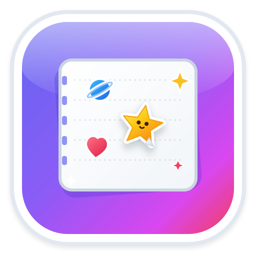

# 🎨 StickerBook STUDIO

<p align="center">
  
</p>

<p align="center">
  <strong>The ultimate tactile digital sticker album, creative canvas, and custom theme pack studio.</strong>
</p>

<p align="center">
  
  
  
  
  
</p>

---

## ✨ Overview

**StickerBook STUDIO** blends the nostalgic tactile joy of peeling, collecting, and placing physical vinyl stickers with a full-blown digital art canvas and creator studio. 

Decorate personalized index cards and scenic wallpapers, experiment with freeform rotational transforms, unleash continuous **Stamp Mode**, and craft your own collectible sticker packs in **ThemePack STUDIO** — complete with custom backdrops, hardware-accelerated shaders, and one-click `.zip` bundle export!

---

## 🚀 Key Features

### 🎴 1. Interactive Tactile Canvas
- **Freeform Manipulation**: Select, smooth-drag, and position any sticker freely on canvas.
- **Precision Controls**:
  - 📏 **Scale Slider**: Seamless zoom scaling from `0.6x` to `2.0x`.
  - 🔄 **Angle & Snap**: 15° rotational snapping or continuous free rotation.
  - 🪞 **Flip**: Horizontal mirroring for dynamic compositions.
  - 🥞 **Z-Order Layering**: Bring to front, send to back, or step through depths.
- **Stamp Mode**: Turn on Stamp Mode to rapidly stamp copies of any active sticker with single clicks/taps across your canvas.
- **Haptic Audio FX**: Web Audio-synthesized tactile sound effects — satisfying peels, pops, stamps, camera clicks, and snaps.
- **Crisp Snapshot Exports**: One-click camera tool to render and export high-resolution PNG artworks ready for wallpapers or sharing.

---

### 📦 2. Four Revamped Core Theme Packs (56 Collectible Stickers)

Every core pack features a custom widescreen backdrop and dedicated die-cut sticker collection:

| Theme Pack | Backdrop Scene | Stickers | Highlights |
| :--- | :--- | :---: | :--- |
| 🚀 **Cosmic Voyagers** | Deep Cosmos Nebula | 16 | Earth, Jupiter, Saturn, Mars, Space Shuttle, Satellite, UFO, Space Kitty, Nebula, Milky Way |
| 🦖 **Prehistoric Titans** | Prehistoric Valley | 16 | T-Rex, Triceratops, Velociraptor, Brachiosaurus, Pterodactyl, Spinosaurus, Fossil, Volcano |
| 🕹️ **Pixel Math Arcade** | Neon Grid Arcade | 16 | Boombox, DJ Booth, VR Headset, Pinball, Retro TV, Game Consoles, Synthwave Palm, Breakdancer |
| 🌊 **Ocean Explorers** | Ocean Reef Floor | 8 | Blue Whale, Coral Reef, Bioluminescent Jellyfish, Mermaid, Sea Otter, Golden Seahorse, Giant Squid |

*Plus the classic **Pastel 3×5 Note Card** ruled canvas for cozy planning and journaling.*

---

### 🛠️ 3. ThemePack STUDIO: The Creator Suite

StickerBook STUDIO includes a built-in authoring suite to design and publish your own custom theme packs:

- **Smart Pack Badges**: Automatic categorization — **Combo** (backdrop + stickers), **Backdrop** (wallpaper only), or **Stickers** (stickers only).
- **Backdrop Studio**:
  - Upload high-resolution images (`.webp`, `.png`, `.jpg`).
  - **Live Shaders & Adjustments**: Real-time slider controls for Opacity (0–100%), Dimming (0–100%), and Hardware-accelerated Blur (0–20px).
  - **Texture Overlays**: Overlay Dot Matrix, Ruled Notebook Lines, or Isometric Grids with customizable tint.
  - **Fit Modes**: Choose between *Cover*, *Contain*, or *Stretch* to fit any canvas aspect ratio.
- **Sticker Minting Station**:
  - Mint custom stickers from transparent PNG, WebP, SVG vector graphics, or emoji stamps.
  - Automatic whitespace trimming for snug, die-cut physical sticker outlines.
  - Assign Rarity Tiers: **Common**, **Rare** *(silver foil)*, **Epic** *(amethyst glow)*, and **Legendary** *(gold prismatic)*.
- **Pack Duplication & Management**: Clone existing packs to remix them with new variations.

---

### 📦 4. Portable `.ZIP` Archives & Legacy JSON

ThemePack STUDIO uses a portable, open archive structure for seamless sharing:

- **One-Click `.ZIP` Export**: Bundles full-resolution transparent sticker assets, backdrop imagery, and a structured `manifest.json`.
- **Drag & Drop Import**: Drop any `.zip` theme pack into the studio to immediately install it into your local vault.
- **Legacy JSON Support**: Backward-compatible support for importing previous `.vaultpack.json` files or pasting raw JSON strings.

---

## 🧰 Tech Stack

- **Framework**: [React 19](https://react.dev/)
- **Language**: [TypeScript](https://www.typescriptlang.org/)
- **Bundler & Dev Server**: [Vite 6](https://vitejs.dev/)
- **Styling**: [Tailwind CSS v4](https://tailwindcss.com/)
- **Icons**: [Lucide React](https://lucide.dev/)
- **Archive Utilities**: [JSZip](https://stuk.github.io/jszip/)
- **Image Generation & Canvas Capture**: [html-to-image](https://github.com/bubkoo/html-to-image)
- **Audio**: Native Web Audio API Sound Synthesizer (Zero external audio file bloat)
- **PWA**: [vite-plugin-pwa](https://vite-pwa-org.netlify.app/)

---

## 🏁 Getting Started

### Prerequisites

Ensure you have **Node.js 18+** installed:

```bash
node -v
npm -v
```

### Installation

1. **Clone the repository:**
   ```bash
   git clone https://github.com/your-username/stickerbook-studio.git
   cd stickerbook-studio
   ```

2. **Install dependencies:**
   ```bash
   npm install
   ```

3. **Start the development server:**
   ```bash
   npm run dev
   ```
   Open your browser and navigate to `http://localhost:3000`.

---

## 📋 Available Scripts

| Command | Description |
| :--- | :--- |
| `npm run dev` | Starts Vite development server on port 3000 |
| `npm run build` | Compiles TypeScript and creates optimized production bundle in `/dist` |
| `npm run preview` | Previews the production build locally |
| `npm run lint` | Runs TypeScript type checking (`tsc --noEmit`) |
| `npm run clean` | Removes build artifacts (`dist`, `server.js`) |

---

## 📂 Project Structure

```text
├── public/
│   ├── backdrops/           # High-resolution WebP theme backdrops
│   │   ├── neon_arcade.webp
│   │   ├── ocean_reef.webp
│   │   ├── prehistoric_valley.webp
│   │   └── space_cosmos.webp
│   └── stickers/            # 56 Core WebP collectible stickers
│       ├── arcade/          # 16 Synthwave & Retro arcade stickers
│       ├── dino/            # 16 Prehistoric Titans stickers
│       ├── ocean/           # 8 Ocean Explorers stickers
│       └── space/           # 16 Cosmic Voyagers stickers
├── src/
│   ├── components/
│   │   ├── StickerVault.tsx               # Main sticker drawer, canvas, and toolbar
│   │   ├── ThemeAndPackManagerModal.tsx   # ThemePack STUDIO creator modal
│   │   ├── StickerIconRenderer.tsx        # Sticker rendering engine (WebP, SVG, PNG)
│   │   ├── UserGuideModal.tsx             # Interactive in-app studio manual
│   │   └── ...
│   ├── data/
│   │   └── stickerPacks.ts  # Core packs & backdrop scenes catalog
│   ├── lib/
│   │   ├── io.ts            # Local storage, pack persistence, and JSON converters
│   │   ├── packZipExporter.ts # ZIP archive compression and manifest builder
│   │   ├── sound.ts         # Web Audio API sound synthesizer
│   │   └── assetPath.ts     # Public asset path resolver for web & PWA
│   ├── types/               # TypeScript models (Sticker, StickerPack, CanvasScene)
│   ├── App.tsx              # Root application state & pack reconciler
│   └── main.tsx             # Application entry point
├── index.html
├── package.json
└── vite.config.ts
```

---

## 💡 How It Works

### Canvas Coordinates & Transforms
Canvas stickers are stored with normalized positions, rotation angles, scale factors, and flip booleans. When capturing screenshots, `html-to-image` renders the exact pixel state including all hardware filters, shadows, and z-indices.

### The Pack Manifest Schema
Theme packs exported as `.zip` contain a clean `manifest.json`:
```json
{
  "id": "pack-custom-neon",
  "name": "Cyber Neon Dreams",
  "description": "Electric cyber city vibes and holographic decals.",
  "isCustom": true,
  "backdrop": {
    "type": "image",
    "imageFileName": "backdrop.webp",
    "fitMode": "cover",
    "opacity": 100,
    "dimming": 10,
    "blur": 0,
    "gridOverlay": "dots"
  },
  "stickers": [
    {
      "id": "stk-custom-1",
      "name": "Neon Glider",
      "fileName": "stickers/neon_glider.png",
      "rarity": "Legendary",
      "tags": ["cyber", "vehicle"]
    }
  ]
}
```

---

## 📱 Progressive Web App (PWA)

StickerBook STUDIO is configured as an installable Progressive Web App. You can install it directly to your home screen or desktop application launcher for an authentic offline sticker album experience!

---

## 📄 License

Distributed under the **MIT License**. See `LICENSE` for details.

---

<p align="center">
  Crafted with ❤️ for sticker lovers, digital artists, and creative minds.
</p>
